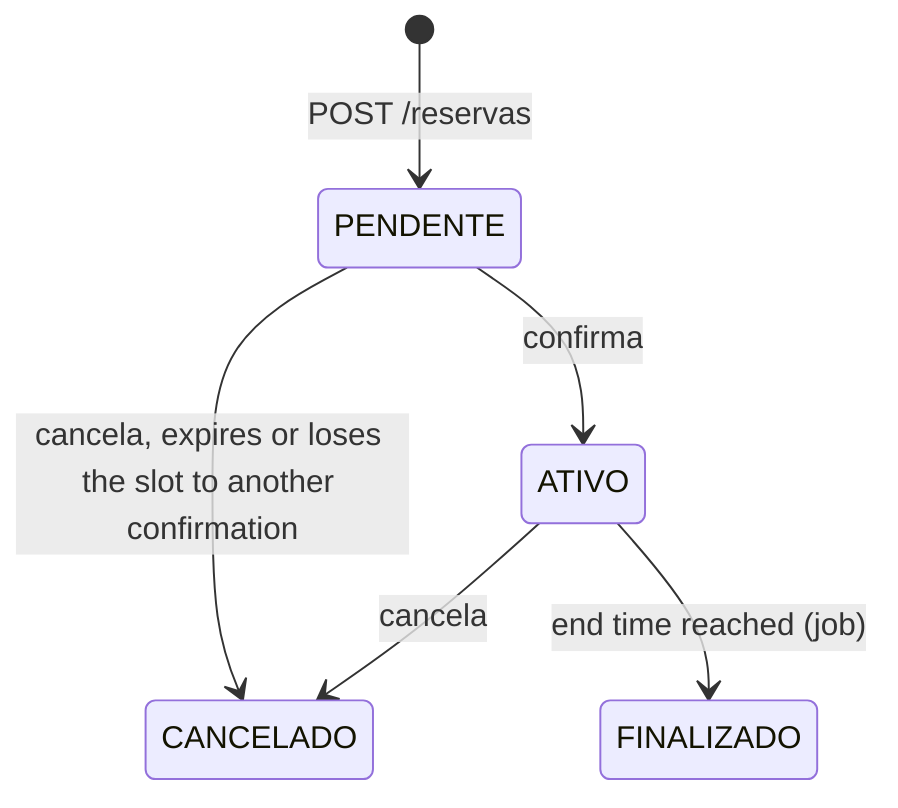

# Booking

[](https://github.com/pricardo91/booking/actions/workflows/ci.yml)

REST API for booking meeting rooms. It manages rooms (`Sala`), users (`Usuario`) and reservations (`Reserva`), with filtering, pagination, safe concurrent confirmations, a background job that closes expired reservations, versioned database migrations and integration tests against a real PostgreSQL.

**Stack:** Java 17, Spring Boot 4, Spring Data JPA, PostgreSQL 17, Flyway, ShedLock, Springdoc (Swagger), Spring Actuator, Testcontainers, JaCoCo, Spotless, Docker, GitHub Actions.

> The domain code (classes, endpoints, error messages) is in Portuguese on purpose; the project documentation is in English.

## Architecture

Each business module (`sala`, `usuario`, `reserva`) is split into four layers, and dependencies point inward:

```
api  ──►  application  ──►  domain
              ▲
infra  ───────┘  (implements the ports declared in application)
```

| Layer | Responsibility |
|---|---|
| `api` | REST controllers, request/response DTOs, Swagger contract |
| `application` | Use cases (services) and the repository **ports** (interfaces) |
| `domain` | Entities, business rules and domain events (`ReservaFinalizada`) |
| `infra` | Port **adapters**: Spring Data JPA, `Specification` filters |
| `job` | Scheduled entry points (only `reserva` has one); they call a use case and hold no business logic |

Cross-cutting code lives in `shared`: `GlobalExceptionHandler` turns business errors (`NegocioException` + `CodigoErro`) into RFC 9457 `ProblemDetail` responses, and `shared/config` holds the `Clock` bean and the scheduling and ShedLock setup.

## Running locally

### Prerequisites

- JDK 17
- Docker Desktop (running)

### 1. Configure the environment

Copy the example file and choose a password. `.env` is git-ignored and never committed.

```bash
cp .env.example .env
```

| Variable | Used by | Description |
|---|---|---|
| `DB_USER` | app, postgres | Database user (required) |
| `DB_PASSWORD` | app, postgres | Database password (required) |
| `DB_URL` | app | JDBC URL. Default: `jdbc:postgresql://localhost:5432/booking` |

### 2. Pick how to run

**Daily development (app in the IDE, database in Docker)**

```bash
docker compose up -d postgres
```

Then run `BookingApplication` from IntelliJ with `DB_USER` and `DB_PASSWORD` set in the run configuration (or loaded from `.env`). Flyway creates the schema on startup.

**Everything in Docker (production-like)**

```bash
docker compose up --build
```

The `app` container only starts after PostgreSQL reports healthy, and exposes its own health check.

Useful commands:

```bash
docker compose down        # stop, keeping the data
docker compose down -v     # stop and delete the database volume
```

The application listens on `http://localhost:8080`.

### Application settings

Set in `src/main/resources/application.yml`. Any of them can be overridden on the command line, for example `--booking.job.finalizacao.intervalo=3000`.

| Property | Default | Meaning |
|---|---|---|
| `booking.job.finalizacao.intervalo` | `60000` | Milliseconds to wait between cycles of the expired-reservations job (counted after the previous cycle ends) |
| `booking.job.finalizacao.tamanho-lote` | `10` | Maximum reservations picked up per status in each cycle |

## API

Interactive documentation (Swagger UI): <http://localhost:8080/swagger-ui.html>
OpenAPI document: <http://localhost:8080/v1/api-docs>

**Salas** (rooms)

| Method | Path | Description |
|---|---|---|
| `POST` | `/api/v1/salas` | Create a room |
| `GET` | `/api/v1/salas` | List rooms, paginated |
| `GET` | `/api/v1/salas/{id}` | Get a room by id |
| `PUT` | `/api/v1/salas/{id}` | Update the name and capacity |
| `PATCH` | `/api/v1/salas/{id}/inativar` | Deactivate a room |
| `PATCH` | `/api/v1/salas/{id}/ativar` | Activate a room |

**Usuarios** (users)

| Method | Path | Description |
|---|---|---|
| `POST` | `/api/v1/usuarios` | Create a user |
| `GET` | `/api/v1/usuarios` | List users |
| `GET` | `/api/v1/usuarios/{id}` | Get a user by id |
| `PATCH` | `/api/v1/usuarios/{id}` | Update name, e-mail and CPF |
| `PATCH` | `/api/v1/usuarios/{id}/inativar` | Deactivate a user |
| `PATCH` | `/api/v1/usuarios/{id}/ativar` | Activate a user |

**Reservas** (reservations)

| Method | Path | Description |
|---|---|---|
| `POST` | `/api/v1/reservas` | Create a reservation (starts as `PENDENTE`) |
| `GET` | `/api/v1/reservas` | List reservations, with filters and pagination |
| `GET` | `/api/v1/reservas/{id}` | Get a reservation by id |
| `PATCH` | `/api/v1/reservas/{id}/confirma` | Confirm a reservation (`PENDENTE` → `ATIVO`) |
| `PATCH` | `/api/v1/reservas/{id}/cancela` | Cancel a reservation |
| `GET` | `/api/v1/reservas/{id}/historico` | List the status changes of a reservation |

`GET /api/v1/reservas` accepts the filters `status`, `idSala` and `idUsuario`, plus the pagination parameters `page` and `size` (1 to 100). Results come newest first.

### Reservation lifecycle

A reservation is created as `PENDENTE` and moves through four statuses:



| Endpoint | What it does | Errors |
|---|---|---|
| `PATCH /reservas/{id}/confirma` | `PENDENTE` → `ATIVO`; cancels the other `PENDENTE` reservations of the same room that overlap it | `404` not found; `409` not `PENDENTE`, or the room already has an `ATIVO` reservation at that time |
| `PATCH /reservas/{id}/cancela` | `PENDENTE` or `ATIVO` → `CANCELADO` | `404` not found; `409` already cancelled or already finished |
| `GET /reservas/{id}/historico` | Every status change of the reservation, oldest first | `404` not found |

Rules worth knowing:

- Only `ATIVO` reservations occupy a room. Two `PENDENTE` reservations may overlap, but the **first one confirmed wins** the slot.
- Intervals are half-open, `[inicio, fim)`: 10:00-11:00 and 11:00-12:00 do not conflict.
- Every status change is written to `reserva_historico` with a reason (`CONFIRMACAO`, `CANCELAMENTO_PELO_USUARIO`, `CONFLITO_COM_RESERVA_CONFIRMADA`, `FINALIZACAO_AUTOMATICA`, `EXPIRACAO_SEM_CONFIRMACAO`), in the same transaction as the change.
- Reservation times are `LocalDateTime` (no time zone); the job compares them with the server clock.

### Health checks

| Endpoint | Meaning |
|---|---|
| `GET /actuator/health` | Overall status |
| `GET /actuator/health/liveness` | The process is alive |
| `GET /actuator/health/readiness` | The app is ready for traffic (includes the database) |

## Concurrency

Two people confirming overlapping reservations for the same room at the same time must produce exactly one `ATIVO` reservation. Two layers guarantee it:

1. **Pessimistic lock on the room row.** Confirm, cancel and the expiry job all lock the room (`SELECT ... FOR NO KEY UPDATE`) before reading any reservation, so every operation on one room runs in a queue and always locks in the same order (no deadlocks). The lock waits at most 3 seconds.
2. **Exclusion constraint in PostgreSQL** (`EXCLUDE USING gist` on room and time range, only for `ATIVO` rows) as a safety net: even a bug in the application cannot save two overlapping active reservations. The application translates a violation into the `409` conflict error.

An integration test confirms two overlapping reservations from two threads against a real PostgreSQL and expects one success and one conflict.

## Background job

`FinalizaReservasVencidasJob` closes reservations whose end time has passed:

- `ATIVO` → `FINALIZADO` (reason `FINALIZACAO_AUTOMATICA`), and a `ReservaFinalizada` event is published.
- `PENDENTE` → `CANCELADO` (reason `EXPIRACAO_SEM_CONFIRMACAO`): a reservation nobody confirmed before it ended can no longer be confirmed.

How it works:

- Each cycle fetches only the ids of expired reservations (oldest end time first, at most `tamanho-lote` per status), then processes **each reservation in its own transaction**: lock the room, reload the reservation, change the status, write the history. A failure in one reservation is logged and does not stop the others.
- The job is **idempotent**: a reservation that is no longer `ATIVO` or `PENDENTE` is skipped, so running it twice (or on two instances) never changes the result.
- The cycle logs how many reservations were processed and how many failed.
- Time comes from an injected `Clock`, so tests control "now" without sleeping.

**Several instances, one execution.** [ShedLock](https://github.com/lukas-krecan/ShedLock) with the JDBC provider stores a lock in the `shedlock` table (created by migration `V3`), using the database clock. The job takes the lock for at most 5 minutes (so a crashed instance cannot block it forever) and holds it for at least 2 seconds after finishing. To see it working, run a second instance (`--server.port=8081`): in each cycle only one of them logs `[start] - FinalizaReservasVencidasJob`.

**Domain event.** `ReservaFinalizada` carries only plain values (reservation, room and user ids, and the instant), because the reservation's lazy associations cannot be loaded once the transaction is closed. The example listener runs after the commit and only logs. Events are in memory, so they are lost if the application stops right after the commit; guaranteed delivery would need an outbox table and a message broker.

## Tests

```bash
./mvnw test
```

Docker must be running: the integration tests start a real PostgreSQL 17 with Testcontainers instead of an in-memory database, so they exercise the same SQL and Flyway migrations as production. The suite covers:

- domain rules;
- services (Mockito), including the expiry cycle with a fixed clock and the per-reservation transaction;
- repositories (filters, ordering, pagination, N+1 prevention and the expired-reservations query);
- concurrent confirmations on the same room;
- the ShedLock lock with two providers sharing one database;
- the HTTP layer (controller tests).

Code style is enforced by Spotless:

```bash
./mvnw spotless:apply   # format
./mvnw spotless:check   # verify
```

## Continuous integration and delivery

- **CI** ([ci.yml](.github/workflows/ci.yml)) runs on every pull request to `develop` or `main` and on every push to `develop`: `spotless:check` and the full test suite, and it uploads the JaCoCo coverage report as an artifact. The `develop` branch is protected and requires a pull request with a passing `build` check.
- **CD** ([cd.yml](.github/workflows/cd.yml)) runs on every push to `develop`: it builds the Docker image and publishes it to GitHub Container Registry as `ghcr.io/pricardo91/booking`, tagged `latest` and with the commit SHA. The image is built in two stages and runs as a non-root user.
- **Dependabot** opens weekly pull requests for Maven and GitHub Actions updates.

## Database migrations

The schema is versioned with Flyway in `src/main/resources/db/migration` and Hibernate only validates it (`ddl-auto: validate`). Never edit a migration that was already applied: add a new `V<n>__description.sql` instead.

| Migration | What it adds |
|---|---|
| `V1__cria_tabelas` | `usuario`, `sala` and `reserva`, with check constraints and indexes |
| `V2__historico_e_exclusao_de_reservas` | `reserva_historico` and the exclusion constraint that forbids overlapping `ATIVO` reservations in one room |
| `V3__create_shedlock` | The `shedlock` table used by the job lock |

## Design decisions

The trade-off behind each choice, in one line:

- **Ports and adapters.** Services depend on repository interfaces declared in `application`; JPA lives in `infra`. Business rules can be tested without a database, at the cost of one extra interface per repository.
- **Rules in the domain, orchestration in the service.** `Reserva` knows how it may change (`confirmar`, `cancelar`, `finalizar`); the service finds data, locks the room and saves. Domain tests need no Spring.
- **Lock plus constraint for concurrency.** The lock keeps operations ordered; the constraint makes a double booking impossible even if the lock is bypassed. A constraint alone caused deadlocks in the concurrency test.
- **Status history in a table, not event sourcing.** An audit trail with the reason of each change, without rebuilding state from events.
- **One transaction per expired reservation.** A failure does not undo the others and the room lock is held for milliseconds; the cost is more round trips than one bulk `UPDATE`, which would also skip the domain rules and the history.
- **ShedLock on the existing PostgreSQL.** No new infrastructure to run several instances; if an instance dies mid-run, the lock frees itself when `lockAtMostFor` ends, and idempotency covers the re-run.
- **In-memory domain event.** An extension point without running a broker; the limit is that it only reaches code in the same application.
- **Real PostgreSQL in tests.** Constraints, locks and migrations behave as in production, at the cost of needing Docker to run the tests.

## Roadmap

Authentication and authorization (Spring Security with JWT, an `ADMIN` and a `USER` profile, and a reservation owner taken from the token) is the next phase. Until then, any client can call any endpoint.
